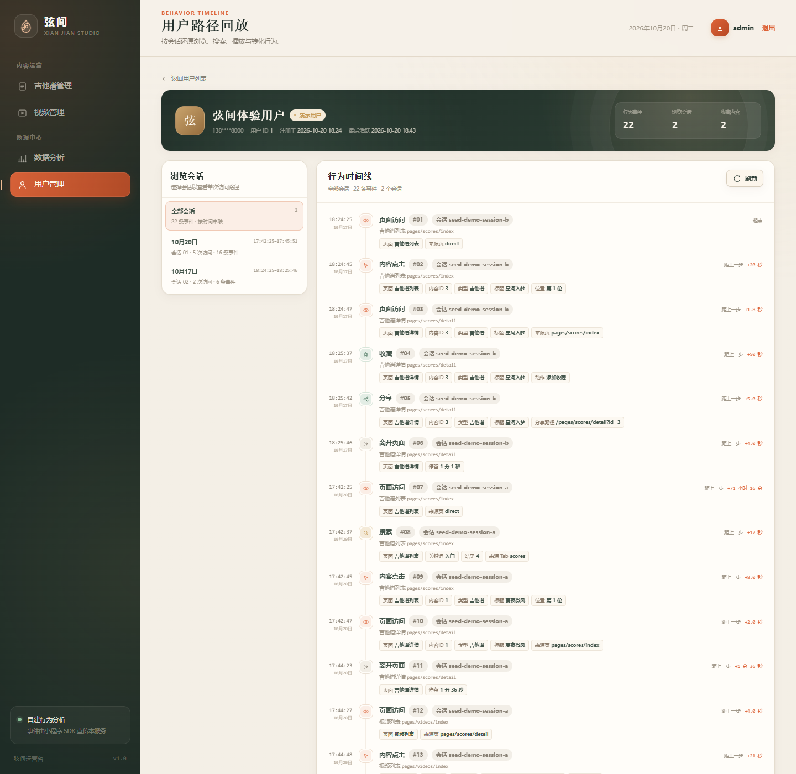

# 弦间 · 吉他谱与直播回放平台

面向抖音小程序的内容平台：吉他谱浏览、直播回放、收藏、手机号登录、行为分析与 Web 管理后台。

> **当前生产架构**：Express + **抖音云 MySQL 8** + **火山引擎 TOS** + 抖音云容器服务（Node 18）。
>
> 已移除 SQLite、本地 `/uploads` 持久化、`BASE_URL` 动态拼接。数据库中的图片/视频字段全部是 TOS 返回的完整 `https://` 地址。


---

## 1. 技术栈

| 层 | 技术 |
|---|---|
| 小程序 | 原生 TTML / TTSS / JavaScript |
| 后端 | Node.js 18+、Express 4 |
| 数据库 | 抖音云 MySQL 8（`mysql2` 连接池） |
| 对象存储 | 火山引擎 TOS（`@volcengine/tos-sdk`） |
| 认证 | JWT、bcrypt、抖音手机号授权 |
| 管理后台 | 原生 HTML/CSS/JS + ECharts |
| 部署 | Docker `node:18-alpine`、抖音云容器服务 |

---

## 2. 核心链路

```text
小程序
  ├─ tt.createCloud({ envID, serviceID })
  │    └─ cloud.callContainer({ path, method, data })
  └─ TOS 图片/视频 HTTPS URL（image/video/downloadFile）

抖音云容器
  ├─ /api/*        Express API
  ├─ /admin/*      管理后台静态资源
  ├─ /static/*     仅系统音频（节拍器回退 WAV）
  ├─ MySQL         用户/内容/行为/收藏/管理员
  └─ TOS           上传与公网访问
```

### 数据与 URL 规则

- 管理后台上传接口 `POST /api/admin/upload?kind=image|video`：
  - 先由 multer 写入临时目录；
  - 再 `putObjectFromFile` 上传 TOS；
  - 返回完整 `https://` 公网 URL；
  - 临时文件在 `finally` 中删除；
  - **不写持久化本地磁盘，不提供 `/uploads` 静态服务。**
- 数据库：
  - `guitar_scores.images` 存 TOS URL JSON 数组；
  - `live_replays.cover_url/video_url` 存 TOS URL；
  - `/api/scores` 直接返回 `imageUrls`，不做任何 Host / `BASE_URL` 拼接。
- 分享图：
  - 吉他谱详情使用当前谱面的 TOS 首图；
  - 视频详情使用 TOS 封面。
- 节拍器：
  - 优先 WebAudio 合成；
  - 不可用时回退系统静态音频 `/static/metronome-click.wav`（不是用户上传内容）。

---

## 3. 功能

### 小程序端

- 吉他谱列表：搜索、标签、分页、下拉刷新。
- 吉他谱详情：多页谱面、预览、下载、收藏、BPM 节拍器。
- 直播回放：分类、搜索、视频播放。
- 抖音手机号登录（mock / real 两种模式）。
- 匿名行为埋点：页面访问、点击、搜索、分享、收藏、视频播放/完播。
- 分享卡片使用 TOS 内容图。

### 管理后台

- 管理员登录、JWT 鉴权。
- 吉他谱 CRUD、上下架、排序、BPM 初始值。
- 视频 CRUD、上下架。
- TOS 图片/视频上传。
- 用户列表：完整手机号（仅管理员接口解密）、会话数、事件数。
- 用户行为路径：时间线、页面停留、步骤间隔。
- 数据看板：PV/UV、页面停留、内容热度、转化漏斗。
- 分析截图：



---

## 4. 目录

```text
guitar-platform/
├── admin/                  # 管理后台静态页面
├── docs/
│   ├── deploy-douyin-cloud.md
│   └── screenshots/
├── miniprogram/            # 抖音小程序
├── server/
│   ├── app.js              # Express 装配
│   ├── config.js           # 环境变量
│   ├── db.js               # MySQL 连接池 / 事务 / 建表
│   ├── index.js            # 启动与优雅关闭
│   ├── seed.js             # MySQL + TOS 种子脚本
│   ├── set-admin-password.js
│   ├── routes/
│   ├── services/
│   └── utils/cloud-storage.js
├── shared/                 # 前后端共享常量
├── sql/schema.sql          # MySQL 8 建表语句
├── static/                 # 系统静态音频
├── scripts/                # TOS 上传自检等运维脚本
├── uploads/seed/           # 仅 seed 上传源，不对外提供静态服务
├── tests/                  # Node test + 临时 MySQL
├── Dockerfile              # node:18-alpine
├── .env.example
├── .env.cloud.example
└── package.json
```

---

## 5. 本地启动

### 5.1 前置

- Node.js **18+**
- MySQL **8.0+**
- 火山引擎 TOS Bucket 与 AK/SK
- 可选：抖音云 CLI（部署用）

```bash
node -v
npm -v
```

### 5.2 安装依赖

```bash
npm install
```

### 5.3 创建 MySQL 数据库

```sql
CREATE DATABASE xianjian CHARACTER SET utf8mb4 COLLATE utf8mb4_unicode_ci;
```

复制环境变量：

```bash
cp .env.example .env
```

至少填写：

```env
DB_HOST=127.0.0.1
DB_PORT=3306
DB_USER=root
DB_PASSWORD=
DB_NAME=xianjian

TOS_ACCESS_KEY_ID=...
TOS_ACCESS_KEY_SECRET=...
TOS_REGION=cn-beijing
TOS_ENDPOINT=tos-cn-beijing.volces.com
TOS_BUCKET=...
TOS_PUBLIC_BASE_URL=https://cdn.example.com

CORS_ORIGINS=http://127.0.0.1:8000,http://localhost:8000
CORS_ALLOW_ALL=0

JWT_SECRET=至少32字符随机值
PHONE_ENCRYPTION_KEY=独立随机值
ADMIN_DEFAULT_PASSWORD=强密码
```

> 项目启动时会自动执行 `sql/schema.sql`（`CREATE TABLE IF NOT EXISTS`），并创建默认管理员。
> 若 MySQL 账号没有建表权限，请先手工执行：
>
> ```bash
> mysql -h 127.0.0.1 -u root -p xianjian < sql/schema.sql
> ```

### 5.4 写入默认数据

```bash
node server/seed.js
```

Seed 会把 `uploads/seed/` 的封面、谱面、视频上传到 TOS，并写入 6 份吉他谱、4 个视频回放。
如果素材已手工上传，可设置 `SEED_ASSET_BASE_URL` 跳过上传。

重置：

```bash
node server/seed.js --reset
```

> `--reset` 会清空内容、用户、行为事件和收藏，保留管理员。

> 云端部署无需执行命令行 Seed：设置 `SEED_ON_START=1`，服务首次启动会自动上传
> `uploads/seed/` 到 TOS 并写入默认内容；已有内容会跳过，不会重复插入。

### 5.5 启动

```bash
npm start
```

- 管理后台：<http://127.0.0.1:8000/admin/>
- 健康检查：<http://127.0.0.1:8000/api/health>
- 默认管理员：`.env` 中的 `ADMIN_DEFAULT_USERNAME` / `ADMIN_DEFAULT_PASSWORD`

健康响应：

```json
{
  "status": "ok",
  "service": "xianjian-guitar-platform",
  "database": "mysql",
  "storage": "tos",
  "time": "..."
}
```

---

## 6. 数据库

完整建表 SQL：[sql/schema.sql](sql/schema.sql)

| 表 | 用途 |
|---|---|
| `users` | 用户、加密手机号、盲索引、openid、活跃时间 |
| `guitar_scores` | 吉他谱、标签 JSON、谱面 JSON、BPM、状态、排序、浏览量 |
| `live_replays` | 视频回放、TOS 封面/视频 URL、分类、状态 |
| `behavior_events` | 埋点事件、`event_time` 毫秒时间戳、extra JSON |
| `favorites` | 用户收藏，唯一键 `(user_id, content_type, content_id)` |
| `admin_users` | 管理员、bcrypt 密码哈希 |

连接池与事务封装：[server/db.js](server/db.js)

- `mysql2/promise`；
- `waitForConnections`、连接池上限 `DB_CONNECTION_LIMIT`；
- `timezone: 'Z'`、`utf8mb4_unicode_ci`；
- `queryOne` / `queryAll` / `execute` / `transaction`；
- 启动自动应用 schema、创建默认管理员；
- 不包含任何 `node:sqlite` 代码。

---

## 7. TOS 上传

配置：

```env
TOS_ACCESS_KEY_ID=
TOS_ACCESS_KEY_SECRET=
TOS_REGION=cn-beijing
TOS_ENDPOINT=tos-cn-beijing.volces.com
TOS_BUCKET=
TOS_PUBLIC_BASE_URL=
TOS_KEY_PREFIX=xianjian
TOS_OBJECT_ACL=public-read

CORS_ORIGINS=https://admin.example.com
CORS_ALLOW_ALL=0
CORS_MAX_AGE=600

# 云端首次启动自动初始化默认内容
SEED_ON_START=1
```

实现：

- [server/utils/cloud-storage.js](server/utils/cloud-storage.js)
- [server/routes/upload.js](server/routes/upload.js)

上传返回示例：

```json
{
  "url": "https://cdn.example.com/xianjian/2026-10/1720000000000-a1b2c3.png",
  "storagePath": "https://cdn.example.com/xianjian/2026-10/1720000000000-a1b2c3.png",
  "storageDriver": "tos",
  "kind": "image",
  "filename": "cover.png",
  "mimeType": "image/png",
  "size": 123456
}
```

限制：

- 图片：`MAX_IMAGE_MB`，默认 20MB；
- 视频：`MAX_VIDEO_MB`，默认 500MB；
- 管理后台接口需要管理员 JWT；
- 数据库只接受完整 HTTPS 资产 URL（`normalizeAssetUrl`）。

小程序需把 TOS/CDN 域名加入 **downloadFile 合法域名**，否则预览/下载会失败。

### 数据库未接通时先验证 TOS

```bash
npm run tos:check
npm run tos:check -- "H:\path\to\cover.jpg"
```

脚本不连接 MySQL，只使用 TOS 环境变量上传测试文件，输出完整 HTTPS URL、HEAD 状态和一条可执行的占位 SQL。

### Express CORS

[server/app.js](server/app.js) 使用 `cors` 中间件：

```env
CORS_ORIGINS=https://admin.example.com,http://localhost:8000
CORS_ALLOW_ALL=0
CORS_MAX_AGE=600
```

- 只允许配置的后台/网页 origin；
- 无 Origin 的小程序/curl/服务端请求不受影响；
- 允许 `Authorization` 预检；
- 生产禁止 `CORS_ALLOW_ALL=1` / `CORS_ORIGINS=*`。

TOS Bucket 自身的跨域规则、控制台位置和 XML/JSON 示例见：
[docs/tos-cors-and-upload.md](docs/tos-cors-and-upload.md)。

### 管理后台适配

[admin/js/api.js](admin/js/api.js) 会校验上传响应：

```js
const assetUrl = payload.url || payload.storagePath;
if (!assetUrl || !/^https:\/\//i.test(assetUrl)) {
  throw new ApiError('上传接口未返回 TOS HTTPS 绝对地址', { code: 'UPLOAD_ERROR' });
}
```

管理后台列表、视频预览、用户时间线都直接使用绝对 URL，不再拼 `/api` 或 localhost。

---

## 8. 小程序云容器配置

修改 [miniprogram/utils/config.js](miniprogram/utils/config.js)：

```js
const CLOUD_ENV_ID = '环境ID';
const CLOUD_SERVICE_ID = '服务ID';
const CLOUD_PUBLIC_BASE_URL = 'https://服务外网域名';
```

- 三者填好后，请求自动使用 `tt.createCloud(...).callContainer`；
- 基础库要求 **>= 2.70.0**；
- 未配置时保留本地 `tt.request` 调试；
- `callContainer` 不需要把 API 域名加入 request 白名单，但 TOS 图片/视频需要 downloadFile 域名；
- 节拍器回退 WAV 走 `/static/metronome-click.wav`，服务域名需要可访问。

---

## 9. 手机号登录

默认：

```env
PHONE_LOGIN_MODE=mock
MOCK_PHONE=13800138000
```

- Mock 模式用于开发/提审，不调用抖音手机号接口；
- 正式上线并开通手机号能力后：

```env
PHONE_LOGIN_MODE=real
DOUYIN_APP_ID=...
DOUYIN_APP_SECRET=...
```

手机号只保存：

- AES-GCM 密文 `phone_encrypted`；
- HMAC 盲索引 `phone_hash`；
- 脱敏号 `phone_masked`。

后台 `/api/admin/users*` 才会解密完整手机号；公开接口只返回脱敏号。

---

## 10. API 摘要

公开：

| 方法 | 路径 | 说明 |
|---|---|---|
| GET | `/api/health` | 健康检查（MySQL + TOS） |
| GET | `/api/public-config` | 标签/分类/登录模式 |
| GET | `/api/scores` | 已发布谱面，`imageUrls` 为 TOS URL |
| GET | `/api/scores/:id` | 谱面详情 |
| GET | `/api/videos` | 已发布视频 |
| GET | `/api/videos/:id` | 视频详情 |
| POST | `/api/auth/login` | 手机号登录 |
| POST | `/api/behavior/batch` | 埋点批量上报 |

用户（Bearer）：

| 方法 | 路径 |
|---|---|
| GET | `/api/auth/me` |
| GET | `/api/user/favorites` |
| POST | `/api/user/favorites` |
| DELETE | `/api/user/favorites/:type/:id` |

管理后台（Bearer）：

| 方法 | 路径 |
|---|---|
| POST | `/api/admin/login` |
| GET/POST/PUT/DELETE | `/api/admin/scores*` |
| GET/POST/PUT/DELETE | `/api/admin/videos*` |
| POST | `/api/admin/upload?kind=image\|video` |
| GET | `/api/admin/users` |
| GET | `/api/admin/users/:id` |
| GET | `/api/admin/analytics/overall` |
| GET | `/api/admin/analytics/user-path` |

---

## 11. 测试

```bash
npm test
```

测试使用 `mysql-memory-server` 启动一个真实 MySQL 8 临时实例，不依赖本机安装 MySQL；TOS 由 fake adapter 替代，不会产生真实对象。

当前覆盖 24 项：

- 健康检查、管理后台静态入口、`/uploads` 404、系统音频；
- CORS 允许/拒绝/预检；
- 管理员登录、JWT；
- 谱面/视频 CRUD、上下架、标签搜索；
- 手机号 mock 登录与密文校验；
- 行为批量去重、非法事件；
- 用户路径、停留时长、漏斗；
- 管理员用户列表/详情、完整手机号解密；
- 收藏增删与内容删除级联；
- TOS-only 上传返回 HTTPS URL；
- Seed 写入 6 谱 + 4 视频，图片 URL 为 TOS；
- Seed 源素材上传 TOS、key 前缀与缓存；
- TOS 签名适配器、URL 构造；
- TOS-only 配置可不依赖 MySQL 加载；
- 生产配置拒绝示例 JWT/管理员密码/CORS 全开；
- MySQL schema 表结构；
- Dockerfile node:18、seed/static 复制。

> 本机没有 Docker 时无法真正构建镜像；测试只验证 Dockerfile 与静态文件路径。
> 真实 TOS 上传需要你的 AK/SK，仓库不包含任何云凭据。

---

## 12. 部署

完整步骤见：[docs/deploy-douyin-cloud.md](docs/deploy-douyin-cloud.md)

核心命令：

```bash
docker buildx build --platform linux/amd64 -t guitar-platform:v1.0.0 --load .
dycloud container:push --service-name "xianjian" --image-id guitar-platform:v1.0.0 --tag v1.0.0 --remark "mysql+tos"
```

控制台：

- 端口 `8000`；
- 填 `DB_*`、`TOS_*`、`JWT_SECRET`、`ADMIN_DEFAULT_PASSWORD`；
- 不需要数据云盘（MySQL 是外部服务）；
- 发布 dev 验证后灰度 prod。

---

## 13. 安全清单

- [ ] `JWT_SECRET` 至少 32 字符随机值，未使用示例值
- [ ] `PHONE_ENCRYPTION_KEY` 独立随机值
- [ ] `ADMIN_DEFAULT_PASSWORD` 强密码，首登后修改
- [ ] MySQL 使用独立业务账号，最小权限
- [ ] TOS Bucket 公共读或 CDN 配置正确
- [ ] TOS AK/SK 只放云端环境变量，不进仓库
- [ ] `DB_SSL` 按云 MySQL 要求开启
- [ ] 小程序下载域名包含 TOS/CDN
- [ ] 正式发布前 `PHONE_LOGIN_MODE=real` 并配置抖音 AppID/AppSecret

---

## 14. 常见问题

**Q：为什么本地启动报“MySQL 配置不完整”？**  
A：项目不再支持 SQLite，必须设置 `DB_HOST/DB_USER/DB_NAME`。

**Q：为什么上传 502？**  
A：检查 TOS AK/SK、Region、Endpoint、Bucket、ACL 和网络。

**Q：为什么 `/api/scores` 还有 localhost？**  
A：运行了旧镜像或旧数据。重新构建镜像、重新 Seed，确认数据库 `images` 是 TOS URL。

**Q：Seed 报缺少素材？**  
A：确认 `uploads/seed/` 存在，或设置 `SEED_ASSET_BASE_URL` 指向已上传的 TOS 目录。

**Q：管理后台图表没有数据？**  
A：Seed 不再写入演示行为；小程序产生真实埋点后才有数据。

**Q：需要挂载云盘吗？**  
A：不需要。数据在 MySQL，文件在 TOS，容器本身无状态。
